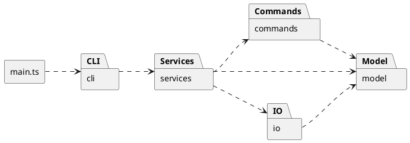

# CLI SVG Editor

## 1. 架构方案

### 1.1 项目概述

本项目旨在基于 TypeScript 实现一个命令行 SVG 编辑器（CLI SVG Editor），通过命令行交互完成 SVG 文档的创建、读取、保存以及图形元素的编辑与管理。

编辑器支持矩形、圆形、椭圆、直线、文本和分组容器六种基本图形类型，并提供图形创建、删除、移动、缩放、属性修改、分组与解组、层级调整、结构查看以及撤销重做等功能。

在软件设计方面，项目采用面向对象的设计方法，通过模块化架构分离用户交互、命令处理、图形模型和文件读写等职责。其中，使用 Composite（组合）模式统一管理基本图形和组合图形，使用 Command（命令）模式封装编辑操作并支持 Undo/Redo。

本项目的设计目标是在满足功能需求的基础上，保持模块职责清晰、依赖关系合理，并为后续增加图形类型、扩展交互方式和演化系统架构提供基础。

### 1.2 模块划分

实际目录结构如下：

```
src/
├── cli/
├── commands/
├── model/
├── services/
├── io/
└── main.ts
```

各模块的职责如下：

| 模块 | 主要职责 |
|---|---|
| `cli` | 负责命令行交互，包括读取用户输入、解析命令参数、输出执行结果及错误信息。 |
| `commands` | 负责封装图形编辑操作，提供命令执行、撤销与重做机制，并管理编辑历史。 |
| `model` | 负责 SVG 图形的领域模型，包括图形属性、几何变换、父子关系及文档结构管理。 |
| `services` | Editor 提供应用入口，协调命令与文档生命周期；当前文档版本由 CommandHistory 唯一持有。 |
| `io` | 负责 SVG 文件的解析、序列化及文件系统读写，实现领域对象与 SVG 文件之间的转换。 |
| `main.ts` | 连接 stdin/stdout/stderr、判断交互模式并启动 Repl，处理顶层流错误。 |

实际跨模块依赖如下，箭头表示源码依赖，不表示调用顺序；Node.js 和第三方库不列入业务模块图。



`main.ts` 是启动与装配入口，但没有直接构造全部对象：Repl 默认创建 Editor，Editor 默认创建 CommandHistory、ShapeFactory 和 SvgFileStore；测试可注入 Editor 或文件访问依赖。入口不包含编辑业务逻辑。

### 1.3 设计模式

本项目主要采用 **Command（命令模式）** 和 **Composite（组合模式）**，分别解决编辑操作管理和图形层次结构管理的问题。此外，借鉴 Memento（备忘录模式）的思想，通过文档状态快照实现撤销与重做。

#### 1.3.1 Command 模式

将编辑操作封装为独立的命令对象，操作请求与具体执行的逻辑分离。

采用以下设计：

| 组件 | 职责 |
|---|---|
| `Command` | 定义统一的命令执行接口 |
| 具体 Command | 封装编辑参数，通过 ID 定位图形并调用领域模型完成操作 |
| `Editor` | 提供应用层接口，创建并提交具体命令 |
| `CommandHistory` | 管理命令执行、状态快照及 Undo/Redo 历史 |

以 `move r1 50 20` 为例：

```
CLI → Editor → CommandHistory.execute(MoveCommand)
                    → MoveCommand.execute(工作副本) → SvgDocument → Shape.move()
```

**撤销重做策略：** 采用 Command 与文档快照相结合的方案。`CommandHistory` 统一保存编辑前后的状态，通过快照恢复实现 Undo/Redo，而不要求各命令分别实现逆操作。编辑命令在工作副本上执行，成功后才提交，以保证操作的原子性。执行成功后还会防御性克隆，隔离命令可能保留的引用；Undo/Redo 直接恢复版本，不重执行命令。失败不改变当前文档、历史栈或屏障，成功的无变化编辑也计一个历史单元。

实现位于 `src/commands/CommandHistory.ts`：它统一持有当前版本、Undo/Redo 栈和屏障状态。Editor 不另存可变文档。成功的 init/read/save/canvas 尺寸修改清空历史并设置屏障，直到下一次成功编辑；显示操作不设置屏障。

#### 1.3.2 Composite 模式

SVG 文档具有树形结构，普通图形和分组容器可以递归组合。
本项目采用 Composite 模式，统一管理基本图形与组合图形。

具体设计如下：

| 组件 | 职责 |
|---|---|
| `Shape`（Component） | 定义 `move()`、`scale()`、`setAttribute()` 等公共操作接口 |
| `Rectangle`、`Circle` 等（Leaf） | 实现各类图形的几何行为和属性管理 |
| `Group`（Composite） | 维护 `Shape` 子节点集合，并递归执行组合操作 |
| `SvgDocument` | 管理图形树、全局 ID 唯一性及结构合法性 |

类层次关系如下：

```text
                  Shape
                    ▲
        ┌───────────┴───────────┐
        │                       │
   基本图形（Leaf）         Group（Composite）
   ├── Rectangle                 │
   ├── Circle                    └── children: Shape[]
   ├── Ellipse
   ├── Line
   └── TextShape
```

实现位于 `src/model/Shape.ts`、五个基本图形类和 `Group.ts`。例如执行 `move g1 50 20`，Group 递归收集叶子图形，在副本上验证全部变换后，调用原对象的多态方法；当前内置图形失败时保持状态，成功时保持对象引用。Group 样式只设置自身，不覆盖子节点显式样式。

`src/model/SvgDocument.ts` 通过对象隔离维护结构约束：添加外部子树时复制，查询时返回独立副本；编辑只能按 ID 作用于内部对象。文档负责全局 ID 唯一、单父和无环约束；Group 仅管理直接子节点、顺序及循环检查。查找采用递归遍历，不维护长期 ID 索引或父节点表，多步结构修改使用内部工作副本保证原子性。

#### 1.3.3 设计模式的协作

Command 处理编辑行为，负责封装操作并参与历史管理；
Composite 模式处理图形结构，将该操作正确地作用于图形树；
两者协同工作。

例如：

```text
用户执行 move g1 50 20
          ↓
      MoveCommand
          ↓
      SvgDocument
          ↓
       Group g1
          ↓
   递归移动所有子图形
```

---

### 1.4 模块依赖规则

本项目采用单向依赖的模块组织方式，尽量避免循环依赖，并使领域模型保持相对独立。

实际依赖图见 §1.2，允许的依赖边界如下。

#### 1.4.1 允许的依赖关系

| 模块 | 允许依赖的模块 | 原因 |
|---|---|---|
| `model` | 不依赖其他业务模块 | 保持图形模型独立，避免受交互和文件处理方式影响 |
| `commands` | `model` | 命令需要通过 SvgDocument 查询并操作图形 |
| `io` | `model` | 文件读写需要访问图形对象并进行格式转换 |
| `services` | `commands`、`model`、`io` | Editor 负责协调命令执行、文档状态及文件操作 |
| `cli` | `services` | CLI 通过应用层接口完成操作，不直接修改图形 |
| `main.ts` | 各模块的公开入口 | 负责初始化对象及完成依赖装配 |

#### 1.4.2 禁止的依赖关系

**规则一：Model 不依赖其他业务模块。**

图形对象只负责自身属性、几何行为和结构关系，不应该直接读取终端输入、访问文件系统或管理命令历史。

这样未来即使由 CLI 扩展为 GUI，也可以复用原有图形模型。

**规则二：Commands 不依赖 CLI、Services 或 IO。**

具体 Command 通过 `SvgDocument` 操作领域对象，不调用 Editor，也不直接进行文件读写。

这可以避免命令执行逻辑与交互方式耦合，以及 `services` 和 `commands` 之间形成循环依赖。

**规则三：IO 不依赖 CLI、Commands 或 Services。**

`SvgReader` 和 `SvgWriter` 只负责 SVG 文件与领域对象之间的转换。文件读取产生的警告或错误应作为结果返回，由上层决定如何展示，不应直接输出到终端。

**规则四：Services 不依赖 CLI。**

Editor 提供与交互方式无关的应用接口，例如 `move(id, dx, dy)`。

CLI 可以调用这些接口，而未来的 GUI 也可以调用相同接口，不需要重新实现编辑业务逻辑。

**规则五：CLI 不直接修改领域模型。**

CLI 负责命令解析、参数转换和结果展示，不能绕过 Editor 和 CommandHistory 直接修改 Shape，否则可能破坏撤销重做机制。

#### 1.4.3 模块依赖的设计依据

上述依赖规则主要依据单一职责原则、关注点分离和依赖倒置思想。

设计时重点考虑：某个模块发生变化时，哪些模块应该受到影响，哪些模块应当保持稳定。

例如：

- 修改 CLI 输入格式，不应影响图形几何行为。
- 修改 Undo/Redo 实现，不应影响 SVG 文件解析。
- 更换 XML 解析库，不应影响 Command 的执行逻辑。
- 新增 GUI，不应要求重写已有的图形操作。

入口的实际装配方式见 §1.2，不承担具体业务逻辑。

已通过源码核查与全模块字面量依赖测试验证这些规则，证据及边界见 §3、§4。

---

### 1.5 未来变化点假设

#### 1.5.1 从 CLI 扩展为 GUI

**变化假设：**

后续版本可能增加图形化交互界面，使用户能够通过鼠标选择、拖动、缩放图形，并通过属性面板修改图形。

**可能受到影响的模块：**

- 新增 GUI 交互模块。
- `services` 可能增加界面状态查询或变更通知接口。
- `main.ts` 可能需要调整应用启动和对象装配方式。

**当前设计的应对方式：**

将用户交互逻辑与领域模型、编辑命令分离。

CLI 和未来的 GUI 都通过 Editor 提供的应用接口执行操作，共用 Command、CommandHistory 和 SvgDocument。

此外，图形对象通过 ID 定位，GUI 不需要长期保存 Shape 的对象引用，从而避免快照恢复后对象实例变化导致的引用失效。

对于 GUI 中连续的鼠标拖拽操作，未来可能需要将多个事件合并为一个编辑事务，以保证一次拖拽只产生一个 Undo 单元。

**当前不实现 GUI 相关框架**，只保证核心业务逻辑不依赖终端交互。

#### 1.5.2 新增图形类型

**变化假设：**

后续可能新增 Triangle、Polygon 等基本图形，或者增加由多个基本图形组成的复合图形。

**可能受到影响的模块：**

- `model`：增加新的 Shape 子类。
- 图形工厂：增加类型名称与图形类的映射。
- `io`：适配新类型的读取与序列化。

**当前设计的应对方式：**

通过 Shape 抽象类统一图形操作，并使用多态实现各图形的几何行为。

对于 `move`、`scale` 等通用操作，新增图形类型后不应要求修改已有编辑命令。

对于不同类型的创建，采用集中的图形工厂进行分派，避免在各模块中重复出现类型判断。

实验允许在命令分发和图形工厂中采用按名称分派的方式，当前将 CommandCatalog 和 ShapeFactory 明确标记为后续扩展时的待重构点，本阶段保留集中分发。

#### 1.5.3 引入图形插件机制

**变化假设：**

后续可能允许通过插件注册新的图形类型，例如实验文档中提到的 `box` 复合图形。

插件可能需要定义图形创建参数、属性行为、内部子图形结构以及序列化规则。

**可能受到影响的模块：**

- 图形创建机制。
- 类型注册机制。
- 属性处理与 SVG 读写机制。

**当前设计的应对方式：**

本阶段不实现完整插件框架，但在设计时尽量集中图形创建逻辑，并通过 Shape 的统一接口减少编辑命令对具体类型的依赖。

未来可以考虑引入 `ShapeProvider` 或类似的类型注册机制，使新增图形类型不再需要修改核心分派逻辑。

**暂不实现的理由：**

Phase 1 只要求支持六种内置图形类型，完整插件系统会增加当前项目的复杂度，属于现阶段没有必要的过度设计。

#### 1.5.4 撤销重做的性能优化

**变化假设：**

后续可能支持更复杂的 SVG 文档，包含大量图形或较长的编辑历史。

此时，每次操作都复制完整文档可能产生较高的时间和内存开销。

**可能受到影响的模块：**

- `CommandHistory`。
- 文档快照及恢复机制。

**当前设计的应对方式：**

本阶段采用完整文档快照，优先保证复杂编辑操作的正确性和实现的可理解性。

同时将快照管理集中在 CommandHistory 内部，避免 CLI、Editor 和具体 Command 直接依赖快照的内部数据结构。

如果后续遇到性能问题，可以考虑增量快照、结构共享或针对特定操作使用逆操作。

**暂不优化的理由：**

本阶段没有明确的大规模文档性能要求，提前实现复杂的增量历史机制可能增加开发与测试成本。

---

## 2. 与 AI 协作的过程记录

### 2.1 模块职责与依赖关系

**问题背景：** 初始方案采用五模块架构，但 Editor 同时承担命令协调、文档管理和文件操作，职责边界容易扩大。

**AI 建议：** Codex 建议保留模块划分，将几何与结构规则放在模型中、编辑操作封装为 Command，让 Editor 只负责应用层协调，避免成为上帝类。

**人工判断：** 接受职责分离，同时暂不引入独立 CommandFactory 或通用 CommandBus，以控制当前规模下的抽象成本。

**最终方案及验证：** 明确了 CLI、services、commands、model、io 的单向依赖。实现中的职责与 §1 一致，源码核查和全模块依赖测试未发现违反约定的跨层导入。

### 2.2 文档对象隔离与结构约束

**问题背景：** Group 提供子节点增删接口，外部若直接修改文档中的 Group，可能绕过单父和全局 ID 约束。

**AI 建议：** 评审比较了 Group 静态 WeakMap 归属记录与文档隔离对象等方案，以限制未经文档检查的结构变更。

**人工判断：** 不引入隐藏的全局归属状态，选择添加和查询均复制子树，所有文档编辑按 ID 进行。

**最终方案及验证：** SvgDocument 统一维护结构约束，Group 保留局部操作接口。`tests/model/SvgDocument.test.ts` 验证输入与查询隔离、共享节点和循环拒绝、跨容器迁移及失败原子性。Group 单独使用时不承担跨容器的全局归属检查。

### 2.3 当前文档归属与历史管理

**问题背景：** Editor 与历史管理器若分别持有可变当前文档，可能出现状态不一致，影响撤销重做与失败恢复。

**AI 建议：** 将当前文档版本和快照栈集中到 CommandHistory，统一执行与提交编辑操作。

**人工判断：** 采用单一状态所有者，并允许命令成功后再防御性克隆一次，接受复制成本以保证引用隔离。

**最终方案及验证：** Editor 只创建命令、协调生命周期和提供查询。`tests/commands/CommandHistory.test.ts` 验证属性、结构和顺序的恢复、失败后 Redo 保留、历史屏障，以及 Undo/Redo 不重新执行命令；应用层测试验证 Editor 通过历史管理器完成编辑。

### 2.4 编辑与保存的样式一致性

**问题背景：** 模型允许设置的部分样式值会被 Writer 拒绝，导致编辑成功后无法保存；仅比较读写往返结果也不足以发现双方一致遗漏的信息。

**AI 建议：** 统一编辑与 IO 的样式校验，检查导出资源限制，并增加不依赖读写双方互相验证的契约测试。

**人工判断：** 只修复一致性问题，不扩大为通用 SVG 支持，也不改变既定分组和继承语义。

**最终方案及验证：** 新增 `src/model/StyleValidation.ts`，由 Shape、Reader、Writer 共用，ShapeFactory 通过图形构造复用校验，避免 model 依赖 io。非法样式在编辑阶段即被拒绝；Writer 移除导入配额，Reader 保留安全上限，超限导出仍不能直接读回。测试补充了合法样式保存读取、非法样式失败后历史保持、手写 SVG 导入及独立 XML 导出断言，验证结果见 §4。

## 3. 架构一致性自查

### 3.1 实际模块与依赖

五模块目录与 §1.2 一致。新增 ShapeFactory/ShapeSchema/StyleValidation 仍归 model，SvgFileStore 归 io，没有增加反向业务依赖。

| 模块 | 实际跨层依赖 | 核查结果 |
|---|---|---|
| main.ts | cli | 与 UML 一致；启动 Repl |
| cli | services | 通过 Editor 编辑；通过 EditorTypes 获取结果类型和公开元数据 |
| services | commands、model、io | 创建具体命令、生命周期协调和文件访问 |
| commands | model | 按 ID 操作文档，保存快照，不访问 CLI/IO |
| io | model | 读写模型和共享校验，不访问 commands/services |
| model | 无其他业务模块 | 封装几何、样式和结构规则 |

源码核查未发现跨业务模块循环依赖；`tests/contracts/Architecture.test.ts` 递归检查全部 src 的字面量导入与重导出，不是通用 TypeScript 依赖分析器。

### 3.2 模式与名称分发

- **Command**：十种编辑操作由十个具体 Command 类实现 `execute(document): CommandResult`，由 Editor 创建、CommandHistory 在副本上执行，参数通过 ID 定位。front/back 在实验表中合为一行，在代码中分别实现。
- **Composite**：Group 与五种叶子均继承 Shape，命令不按叶子类型分派 move/scale/set；具体变换在模型内实现，集合与字段均封装。当前预检策略针对内置图形，不承诺任意插件的副作用原子性。
- **名称分发与元数据**：CommandCatalog 集中命令名的解析、执行与反馈；ShapeFactory 是类型名到具体构造类的唯一入口。ShapeSchema 描述标签、类名和属性，ShapeSyntax 保留 CLI 参数及展示布局；这些表属于描述性元数据，不是另一套图形创建或几何算法分发。

Reader 仍有 text/g 内容特例，Writer 和 DocumentViewBuilder 仍使用类名识别元数据。名称分派的严格验收口径与未来类名变更风险尚在，不能声称已实现无需修改核心的插件机制。

### 3.3 实验原文与项目约定

| 项目 | 当前决策及边界 |
|---|---|
| 参数语法 | `init 400` 高度取 600；canvas 查询无参数，修改必须同时给宽高；group 接受至少一个成员。实验的 `canvas [w] [h]`、`group <newGid> <id1> <id2>…` 未完全消除歧义，按项目约定实现，仍需确认验收口径。 |
| 分组位置与顺序 | 新 Group 放在最近公共父容器的最早受影响分支处，成员按原文档 DFS 顺序排列；拒绝祖先和后代同时入组。LCA/插入位置是项目补充约定。 |
| 继承样式 | group/ungroup/addto 保留显式样式，不固化原父容器的继承值；换父容器可能改变外观。实验明确结构和顺序，未明确要求外观保持。 |
| 导入范围 | 已允许根节点 version=1.0/1.1/2.0；视觉属性不能静默忽略。仍为有限 SVG 子集，详见 §4.2。 |
| 样式与保存 | 共用 StyleValidation；非法值失败不进入历史。导出不再施加导入配额，但不保证任意大小文档的性能或可再次导入。 |
| 错误分类 | addto 目标不存在为 `no such shape`；create 的 in 目标不存在仍为 `no such container`，非容器仍为 `not a container`。 |

CLI 另采用以下已确认约定：仅双引号分组，支持转义双引号与反斜杠，其他反斜杠保留；忽略空行及允许缩进的行首 # 注释，不支持行尾注释。命令名大小写敏感；help 可在无文档时使用；EOF 结束，交互模式显示 `svg>`，脚本模式不显示提示符。成功输出到 stdout，warning/error 到 stderr，异步命令逐行 await。

read/save 失败不改变文档、历史或默认路径；默认保存路径仅取最近成功 read 的路径，显式 save 不更新它，init 成功清除它。IO 期间禁止编辑和第二个 IO 请求，查询可读取已提交状态。

## 4. 质量保证手段

### 4.1 验证证据

| 层次 | 实际证据 |
|---|---|
| 模型单元测试 | `tests/model/`：六种图形、属性白名单、数值与溢出校验、递归变换、克隆隔离、结构/顺序和失败原子性。 |
| 命令与应用集成 | `tests/commands/`、`tests/services/`：快照恢复、Redo 保留、屏障、默认路径、IO 忙碌保护。 |
| CLI 集成 | `tests/cli/`：参数与转义、输出流、错误后继续、真实入口脚本及文件 read/save。 |
| 独立实验契约 | `tests/io/SvgContract.test.ts`：手写导入数据的明确期望、直接解析导出 XML；`tests/contracts/Session.test.ts`：实验 §6 完整会话及 RGB/HSL 保存读取。 |
| 故障与项目约定 | `tests/io/SvgFileStore.test.ts`：临时文件已写入部分字节后抛错，旧目标完整；`tests/contracts/GroupStyle.test.ts`：显式样式与父容器变化；Architecture 测试检查全部业务层依赖。 |

自动化验证结果：`npm run build` 通过；`npm test` 的 **26 个测试文件、535 项测试全部通过**；`git diff --check` 通过。测试数量对应最近一次已执行的代码验证，本次文档润色未重新运行测试。

手动验收已通过 CLI 完成六种图形创建、几何编辑、分组与解组、Z-order、Undo/Redo、历史屏障、错误恢复及 SVG 文件读写验证，并在浏览器中预览了生成的 SVG 文件，基本显示正常。该验收确认了主要交互流程和基本显示效果，不代表已验证像素级渲染一致性或所有浏览器的兼容性。

### 4.2 SVG 支持范围与限制

- Reader 支持 XML 1.0、UTF-8 和 SVG 命名空间中的 rect/circle/ellipse/line/text/g；保留嵌套、绘制顺序、文本和显式样式，不自动写入默认样式。必需几何属性不得省略，数值为有限十进制数，不接受 px/% 长度；画布宽高为正。
- viewBox 可省略；存在时仅支持 `0 0 width height`。缺失或空白图形 ID 先预留全文件显式 ID，再按标签+序号补齐并警告；重复显式 ID 拒绝。
- 根节点 version=1.0/1.1/2.0 作为元数据接受，不表示支持相应版本的全部特性；有限白名单还允许忽略 data-kind。根级 id、fill/stroke 等目前仍不支持；不会把无法表示的继承样式静默丢弃。
- 公共样式为 fill/stroke/stroke-width。颜色支持名称、3/4/6/8 位十六进制、RGB/HSL（含透明度与 hue 单位），以及 none/transparent/currentColor/inherit/initial/unset；不支持完整 CSS 表达式。空值、URL、CSS 变量和非法值被拒绝。
- 拒绝 DOCTYPE、未知元素、事件属性、危险资源引用及无法表达的 transform/opacity/font-size/text-anchor 等视觉属性。使用 saxes 严格校验 XML，再由 xmldom 构建 DOM；Writer 生成标准 XML，SvgFileStore 同目录临时写入后 rename 替换目标。
- Reader 导入上限为 **1 MiB、128 层图形嵌套、10,000 个图形元素**（不计 svg 根节点）。Writer 不施加这些配额，仍校验样式及 XML 字符；超限导出可能无法再读入，递归实现和完整快照仍受内存与调用栈限制。

### 4.3 未验证与交付边界

尚未验证像素级渲染一致性、真实磁盘耗尽、跨平台文件系统权限与崩溃持久性；真实终端 Ctrl-C 也未列入本次已确认的手动验收范围。部分写入故障使用真实临时文件加注入异常，不等同于耗尽磁盘；样式测试验证显式属性与继承来源，不计算渲染像素。依赖测试覆盖当前字面量相对路径，不保证识别运行时计算路径、未来路径别名或任意动态加载。

本项目不包含 GUI、box 插件或完整 SVG/CSS 支持。提交历史、远程推送、截止时间以及最终提交的 `final` 标签需人工核查和执行，不能由测试通过推断已完成交付。
