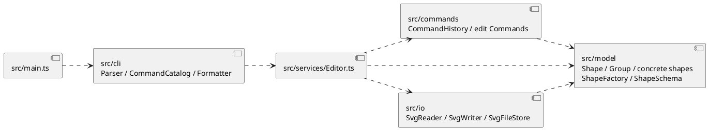
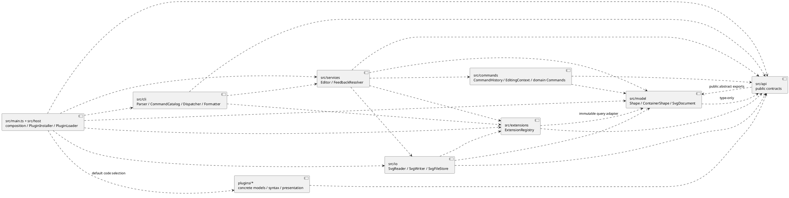

# SVG 编辑器：插件式 CLI 与 VSCode 扩展

本项目在 TypeScript CLI SVG 编辑器上完成插件式重构，并提供独立 VSCode 扩展。默认模式保留 rect、circle、ellipse、line、text、g 及原有命令；可选插件提供 stats、dir、box 和保存差异星号。命令编辑、Composite 几何算法及快照撤销机制继续复用。

当前为最终交付候选，`p2` 尚未创建。原始基线为 `final`（`177eb20e131849132a777ec0ca576c37a5b00728`）；冻结提交为 `kernel-freeze`（`3001b314a370a2df86f9ac476be9b54e0358e3b1`）。运行代码候选为 `97b8e97ddd080b3e6bcc29b2033bae60e0d81a0a`，之后的验收证据提交没有修改运行代码。指标和最终标签复验见后文。

## 安装、启动与使用

已验证环境为 Node.js 24.10.0、npm、TypeScript 7.0.2，模块系统为 CommonJS，CLI 使用 tsx。仓库根目录执行：

```sh
npm ci
npm run build
npm test
npm run cli
# stats、dir、box；保持无星号的显示
npm run cli -- --config plugins.config.json
# 全部可选插件，box标签先于星号
npm run cli -- --config plugins.star.config.json
```

依赖与锁文件在根目录；VSCode 扩展有独立工程和锁文件。`npm run build` 只做类型检查，不生成 CLI 构建产物。交互终端显示提示符，管道模式不显示提示符/启动横幅，不回显输入；错误输出到 stderr，命令失败后继续处理后续输入。

```text
init 800 600
create rect r1 20 30 100 60 blue
create circle c1 180 60 20 red
group items r1 c1
move items 10 0
set r1 fill green
undo
redo
tree
show r1
save drawing.svg
```

使用 `help` 查看完整语法及已加载插件帮助。内置命令包括 init、canvas、create、delete、move、scale、set、group、ungroup、addto、front、back、tree、show、read、save、undo、redo、help、quit；`#` 注释及带引号文本由 Tokenizer 处理。SVG 文件另存，不要把提示符或示例输出写入输入脚本。

启用 box 后可执行 `create box n1 120 100 160 60 "开始"`、`set n1 fill #f5a623`、`set n1 label "处理数据"`。启用 stats 后按子节点顺序 DFS，叶子类型按首次出现顺序输出；g/box计容器，SVG根不计容器，box内部叶子计入总数。dir无需画布，列出**进程 cwd**而非SVG文件目录，目录在前、各类按区分大小写的字符串顺序排序，含隐藏项、不递归、不跟随符号链接；非目录项按FILE处理。

## 架构与复用

### 重构前：final 的实际依赖

路径以 `git show final:<path>` 查看。图中箭头是业务模块源码依赖，省略Node及XML库。



final中的类型工厂、属性schema、解析和展示认识具体图形；CLI命令语法/分派/反馈集中在CommandCatalog。Editor默认构造工厂和文件存储，图形/命令追加会触及已有代码。

### 重构后：当前依赖



图中Host包含组合根和加载器，只有组合根静态选择默认插件；通用加载器没有具体插件导入。`model → api`仅允许类型依赖，不形成运行时反向依赖。插件只导入 [公开入口](../src/api/index.ts)、本包文件和允许的 `node:` 内建模块，不引用Editor、Session、SvgDocument或CommandHistory。字面量依赖、类型导入边界及插件隔离由 [Architecture.test.ts](../tests/contracts/Architecture.test.ts) 检查。

保留十种领域编辑Command、Editor及CommandHistory，未另建BuiltinEditorFacade或第二套模型。`ContainerShape`提取原Group算法：遍历后代叶子、累计预检、统一move/scale；普通Group与Box继承它，`asContainer()`和稳定`kind`代替具体类分派。独立Group允许的共享叶子行为保留；文档树另行要求单父、无环、ID非空且全局唯一。clone须保留语义、属性、层级、顺序和行为，不修改源对象且正确复制全部可变实例状态。

CLI内置具体图形、Factory/Schema兼容入口迁至 [builtin-shapes](../plugins/builtin-shapes/)，语法、命令计划及默认反馈迁至 [builtin-commands](../plugins/builtin-commands/)。旧type字段仅迁移兼容，新插件按kind分派。Reader/Writer和展示通过Registry访问Provider；不因新增box修改内核。接口与实现增加了代码量，指标不宣称“重构必然减少代码”。

## 四扩展点清单

公开接口位于内核侧，各实现均为类实例。下表列出实际消费路径；注册统一使用 [ExtensionRegistry.register](../src/extensions/ExtensionRegistry.ts)，向插件只提供限时RegistrationContext，不暴露内部Map。

| 接口与职责 | 内核调用文件与函数 | 具体实现 | 禁用可选扩展后的缺省行为 | 违约与错误处理 |
|---|---|---|---|---|
| [ShapeProvider](../src/api/ShapeProvider.ts)：kind、SVG selector、parseCreate/create/read/write、readAttribute、present及可选反馈 | `CommandCatalog.parse`→`shapeServices.parseCreate`；`Editor.executeInvocation`→`shapeServices.create`；`SvgReader.read`→`shapeForSvg/provider.read`；`SvgWriter.write`→`provider.write`；`Formatter.label/position/show/tree`→`present`；`FeedbackResolver.prepare`→`describeOperation` | [BuiltinShapeProvider](../plugins/builtin-shapes/BuiltinShapeProvider.ts)的六实例；[BoxProvider](../plugins/shape-box/BoxProvider.ts) | 六种默认图形保留；无box时`g data-kind="box"`按普通g读回；create box报`unknown shape type: box (is the plugin loaded?)` | 重复kind/selector注册失败；create返回错误ID/kind报`provider returned wrong shape identity`；已识别非法复合节点拒绝整个read，不能fallback；读写/校验失败不提交文档 |
| [Command](../src/api/Command.ts)：name、syntax/help、parse及query/edit/host执行计划；区别于内部领域Command | `Parser.parse`→`CommandCatalog.parse/help`；`Dispatcher.execute`执行query/edit，`Dispatcher.host`授予单一宿主能力；edit进入`Editor.executeInvocation` | [BuiltinCommand](../plugins/builtin-commands/BuiltinCommand.ts)由BuiltinCommands注册；[StatsCommand](../plugins/command-stats/StatsCommand.ts)、[DirCommand](../plugins/command-dir/DirCommand.ts) | 原命令保留；stats未加载时报`unknown command: stats`（dir同理），help不列出 | 重复name拒绝；异步parse拒绝；非法计划报`invalid command invocation`；参数由插件报usage；查询不进入历史，编辑失败回滚 |
| [TreeDecorator](../src/api/TreeDecorator.ts)：基于深冻结document/saved/node返回行尾标签 | `Formatter.tree`→`ExtensionRegistry.treeTags`；`Editor.observation`提供保存基准，node=null表示SVG根 | [BoxDecorator](../plugins/shape-box/BoxDecorator.ts)、[ModifiedStarDecorator](../plugins/tree-star/ModifiedStarDecorator.ts) | 零装饰器时标签为空，Phase 1 tree逐字节不变 | 重复name拒绝；非数组、非字符串或含CR/LF标签报`invalid tree tags`；装饰器异常作为命令错误，不能修改只读文档 |
| [AttributeHandler](../src/api/AttributeHandler.ts)：handles只读匹配，apply通过窄AttributeMutation修改，可选反馈 | `Editor.executeInvocation`的setAttribute→`ExtensionRegistry.attributeAction/selectAttribute`；`Editor.setAttribute/executeAttributes`复用事务；提交前`FeedbackResolver.prepare` | [BoxAttributes](../plugins/shape-box/BoxAttributes.ts)处理box fill/label | 零命中调用setDefault，沿原内置属性白名单处理 | 多命中报`attribute handler conflict: <id>/<name>`，无优先级；非同步boolean拒绝；apply/校验/反馈失败整个编辑及历史不变，不再回退默认处理；未知属性沿原白名单报错 |

选择键是SVG **namespace URI/localName/dataKind**，不是前缀。精确语义selector优先，未知dataKind仅退到同URI/标签的基础Provider；不认识的元素仍拒绝。新插件不能依赖内置Factory/Schema内部入口。

### 事务、反馈与权限

[CommandHistory](../src/commands/CommandHistory.ts)持有唯一可变当前版本和前后快照。一次编辑在工作副本执行，候选树校验、结果复制及反馈准备均在提交前完成，最终提交克隆隔离插件保留的对象；失败不动文档和历史栈。undo/redo恢复快照，不重执行原编辑；准备失败不移动栈。保存的历史结果是纯值，不保存插件函数或模型引用。CommandResult保留十种操作名联合及通用参数字典，不承诺每种操作参数都是独立强类型。

查询返回隔离且深冻结的ShapeView/DocumentView；MutationPort及更窄AttributeMutation在成功或失败后均失效。host计划仅授予init/read/save/canvas/undo/redo中声明的单一能力；不把宿主操作伪装成查询，也不暴露完整Editor。一个属性处理器可修改多个部件，但只有一个undo单元。注册和编辑要求同步的路径拒绝Promise。成功init/read/save/canvas尺寸修改保留原IO历史屏障；普通查询不设置屏障。save/read失败不更新保存基准，init清除基准。

`FeedbackResolver.prepare`按显式属性/图形反馈所有者→目标Provider→Command顺序回退；undefined表示继续回退，空数组表示有意不输出。反馈在提交前准备，undo/redo也使用准备后的结果。单条反馈不含CR/LF；内置默认反馈对文本控制字符转义，原Golden及文本兼容测试保持通过。

这是协作式插件架构，不是恶意JavaScript沙箱。freeze和引用检查不能证明Map、私有字段、闭包等任意内部状态都已隔离；插件负责正确clone和同步纯validate，容器累计预检依赖叶子操作同步、确定且clone正确。

## 两种装配与配置

默认组合根为 [src/host/composition.ts](../src/host/composition.ts)，仅选择两个内置包。可选插件不在默认组合根中硬编码。

- **代码装配**：在唯一顶层组合根静态import插件，调用PluginInstaller.installCode；不能直接activate绕过manifest和原子注册。实际改动见 [代码装配补丁](../tests/acceptance/code-assembly.patch)及演示提交。
- **配置装配**：`main.ts --config <file>`通过 [PluginLoader.loadFile](../src/host/loading/PluginLoader.ts)解析字符串模块。相对模块路径以配置文件所在目录为基准，包名使用Node解析规则。无参数默认只装内置能力。

```json
{
  "plugins": [
    { "module": "./plugins/command-stats", "options": {} },
    { "module": "./plugins/command-dir", "options": {} },
    { "module": "./plugins/shape-box", "options": {} },
    { "module": "./plugins/tree-star", "enabled": true, "options": {} }
  ]
}
```

`enabled:false`完全跳过，数组顺序就是注册顺序；options按纯值复制传入activate，当前四包无需配置参数。包manifest的contributes包含shapes/commands/decorators/attributes四类名称列表，缺省为空；如box声明shapes=[box]、attributes=[box-attributes]、decorators=[box-type-label]。模块须有default export，其activate(context,options)同步注册贡献。生产入口在真实CommonJS+tsx环境验证，非仅mock。

A/B都经过 [PluginInstaller.install/installCode](../src/host/loading/PluginInstaller.ts)和Registry暂存→重名/selector/manifest校验→原子提交。失败撤销当前插件全部贡献，保留既有插件并继续加载后续插件。配置非法时打印错误，以默认内置能力启动。

| 失败 | stderr格式 |
|---|---|
| 顶层模块不存在 | `error: plugin not found: <module>` |
| 缺default export | `error: plugin has no default export: <module>` |
| 清单不一致 | `error: plugin manifest mismatch: <name> (declared: …, registered: …)` |
| activate/求值/内部依赖失败 | `error: plugin failed to activate: <name> (<reason>)` |
| 重复贡献名 | `error: duplicate registration: <category>/<name>` |
| 非法配置 | `error: invalid plugin config` |

模块解析成功之后的依赖缺失归为激活失败，不误报顶层模块不存在。selector冲突及非法方法等在注册验证时拒绝，经加载器作为激活失败报告。

### 真实提交与运行证据

[committed-result.json](evidence/assembly/committed-result.json)记录已执行的独立提交验证：

| 装配 | 演示分支 | 提交 | 父提交与运行修改 |
|---|---|---|---|
| A | demo/phase2-code-assembly | `20aeb40775c0e20f3849f86b6b31c07f7fe35b64` | 父为冻结F；新增四包，仅修改src/host/composition.ts |
| B | demo/phase2-config-assembly | `fc3c944d47e337a3a8becac75131b14b2406ad98` | 父为冻结F；新增同四包及plugins.config.json，已有运行代码零修改 |

演示分支已由开发者推送。报告含真实SHA、完整name-status、插件/输入/输出hash、相同options与顺序、双边类型检查。§6、§6.1 B、新增stats/dir会话在同一绝对cwd重置相同初始文件后执行，分别比较stdout、stderr、退出码及保存SVG，日志在cwd外，不trim或归一化。禁用全部新增插件后，对实际导出的final运行三个基础会话并与旧Golden比较。`g#n1 (box) *`验证标签共存。

```sh
node tests/acceptance/assembly.cjs
node tests/acceptance/assembly.cjs --a-ref 20aeb40775c0e20f3849f86b6b31c07f7fe35b64 --b-ref fc3c944d47e337a3a8becac75131b14b2406ad98
node tests/regression/phase1-baseline.cjs
```

详见 [验收条件与Git复核步骤](evidence/assembly/README.md)、[输入与预期](transcript/acceptance/)、[原始Golden来源](transcript/BASELINE.md)及 [冻结规则](../docs/metrics/FREEZE.md)。真实提交报告与早先隔离副本报告分开，不用模拟结果代替Git提交差异。

## 设计决策记录（ADR）

### ADR：属性扩展与单事务

接受：handles只读匹配；零命中回退白名单，多命中拒绝；apply使用窄端口，一次set为一个历史单元。理由：避免隐式优先级，复用原快照机制。代价：不能自动组合冲突处理器，异步/外部副作用不在可回滚范围。实现与证据：ExtensionRegistry.selectAttribute/attributeAction、BoxAttributes及 [Box.test.ts](../tests/plugins/Box.test.ts) 的冲突/部分修改/反馈失败回滚测试。

### ADR：读回降级与复合节点保护

接受：未安装语义Provider时由同标签基础Provider降级；已识别但不合法时拒绝整个read。Box必要直接子节点为id-rect/rect与id-label/text，域validate保护存在、类型、ID及父级；普通结构操作也不能破坏。理由：普通SVG可读且不静默产生半个box。代价：缺插件时语义丢失，保留普通g内容；重新安装也不能修复已被外部破坏的结构。证据：SvgReader.read、Box.validate及Box.test读回/降级测试。

### ADR：内容差异、祖先与标签顺序

接受：与最近成功read/save的内容比较；init无基准，根和新节点立即标星；子树变化传播到祖先；多个标签按注册顺序拼接，每个前置一个空格。undo回保存内容清除星号，同值编辑不标星。理由：显示实际未保存内容；标签彼此无感知。代价：比较有遍历成本，当前直接比较最坏平方级。实现：Editor.observation与ModifiedStarDecorator.tags；[TreeStar.test.ts](../tests/plugins/TreeStar.test.ts)覆盖保存/撤销/IO失败/组合。

### ADR：manifest在提交注册前校验

接受：所有装配共用Installer，activate只暂存，贡献名称集合和类别匹配后原子发布；失败继续后续插件。理由：半注册会使启动状态依赖失败发生位置。代价：不能回滚模块顶层外部副作用，插件应避免此类副作用。证据：PluginInstaller.install、ExtensionRegistry.register及 [加载器测试](../tests/contracts/PluginLoading.test.ts)。

## dir 的 Adapter 模式

客户端 [DirCommand.parse](../plugins/command-dir/DirCommand.ts)只依赖目标接口 [DirectoryPort](../plugins/command-dir/DirectoryPort.ts)：currentDirectory和异步read返回{name,directory}。适配器 [NodeDirectoryAdapter](../plugins/command-dir/NodeDirectoryAdapter.ts)把Node的process.cwd及fs.readdir(withFileTypes)的Dirent转换为该接口，排序/格式化仍由Command负责。它是对象Adapter，不继承Node文件系统，也不把Node Dirent泄漏给命令。

测试替身可返回固定列表或抛错；[Dir.test.ts](../tests/plugins/Dir.test.ts)同时使用真实临时目录验证排序/隐藏项/符号链接及失败。参数只能为空，否则`usage: dir`；读取失败`cannot read directory: <cwd>`，由CLI加error前缀。查询不改变画布和undo/redo，也不依赖是否打开SVG。

## VSCode：宿主、Provider、模式与复用

独立工程 [vscode-extension](../vscode-extension/) 的API兼容范围为VSCode `^1.85.0`，最低版本来自类型声明，不代表所有版本已实测。Node自动化环境同上。

```sh
cd vscode-extension
npm ci
npm test
```

在macOS VSCode只打开该工程文件夹，Run and Debug选择 **Run SVG Outline Lab**，F5（必要时Fn+F5）。launch的preLaunchTask编译入口，Extension Development Host打开fixtures。先不打开example.svg检查标记；打开后查看原生Outline。SVG若默认使用Image Preview，选择 **Open With... → Text Editor**。Git的U/M可与[]共存，演示可临时关闭git.decorations.enabled，不能关闭Explorer全部badges。完整启动与排错见 [扩展说明](../vscode-extension/README.md)。

[extension.activate](../vscode-extension/src/extension.ts)创建两个Provider，并向window.registerFileDecorationProvider及languages.registerDocumentSymbolProvider注册，返回Disposable统一加入context.subscriptions。VSCode宿主负责激活、Explorer/Outline界面、发起请求、编辑后刷新与范围导航；扩展负责计算返回值，既不改文件名/路径，也不自己创建替代TreeView。

- [SvgFileDecorationProvider](../vscode-extension/src/SvgFileDecorationProvider.ts)按.svg后缀及workspace.fs.stat确认文件、排除目录；watcher/rename事件刷新，监听及Provider可释放，无全工作区索引。宿主通过接口组合附加展示信息，具有装饰效果，但Provider并不实现/包装Explorer的同一Component接口，也不委托被包装对象，所以不等同经典GoF Decorator。
- [XmlOutlineParser](../vscode-extension/src/XmlOutlineParser.ts)独立使用saxes，保留根、任意嵌套和非CLI标签，无id不补id。[SvgDocumentSymbolProvider](../vscode-extension/src/SvgDocumentSymbolProvider.ts)把范围树转换为DocumentSymbol，是源模型→宿主接口的Adapter；文件状态→FileDecoration也有适配关系。
- 解析按代码点输入、按原始字符串累计UTF-16偏移，不把SAX列号当作VSCode character；range覆盖元素，selectionRange覆盖开始标签名，经positionAt定位。非法/不完整XML返回空大纲，修复后重新解析恢复；中文/emoji、CRLF/LF、CDATA等有自动化测试。
- Phase 1 SvgReader严格校验有限图形、几何和样式，自动分配缺失ID且没有源码范围；Shape/Group遍历的是已验证领域树，不能代表任意或正在编辑的XML。直接复用会放宽CLI或丢失大纲信息。因此只复用XML库的技术选型，独立解析和遍历，不抽取额外共享领域模块。

开发者在macOS真实Host完成12项人工功能验收；七张原图引用如下。原始字节及SHA256见 [截图证据索引](evidence/vscode/README.md)，自动化模拟API测试不作为UI证据。

| 原图 | 内容 |
|---|---|
| [文件标记](evidence/vscode/01-file-decoration.png) | 未打开SVG也有[]；普通文件及.svg目录排除 |
| [Outline定位](evidence/vscode/02-outline-navigation.png) | 根、嵌套、无id/非内置元素及中文emoji后tspan准确定位 |
| [实时更新](evidence/vscode/03-outline-live-update.png) | 未保存circle ID变化反映到Outline |
| [非法XML](evidence/vscode/04-invalid-xml.png) | 删除根闭合标签后空大纲，编辑器正常 |
| [恢复XML](evidence/vscode/05-xml-recovery.png) | 合法后自动恢复 |
| [创建刷新](evidence/vscode/06-decoration-create.png) | 新SVG自动标记 |
| [重命名刷新](evidence/vscode/07-decoration-rename.png) | SVG改TXT后标记消失 |

反向重命名与删除由开发者确认通过，没有对应独立截图。示例已恢复，临时测试文件不作为交付。未提供精确VSCode/macOS版本号，不补造环境信息。

## AI 协作中的检查与修正

| 建议或问题 | 人工判断与最终处理 | 可核验结果 |
|---|---|---|
| 为迁移命令增加BuiltinEditorFacade | 人工决定保留Editor及领域命令，避免重复门面；仅迁CLI语法/执行计划 | Editor、commands与builtin-commands的实际边界 |
| freeze/反射可完整证明任意clone隔离 | 人工指出Map/私有字段/闭包边界；保留合理辅助检查，明确合作式插件契约 | Shape契约注释及DomainTransaction契约测试 |
| 插件禁止所有非公开入口依赖会误拒绝Node内建模块 | 人工允许node:且经node.isBuiltin验证的内建模块；继续禁止宿主/私有内核/其他插件 | Architecture.test.ts正反例及dir实际Adapter |
| 先用隔离副本验证双装配 | 人工要求另有真实提交差异证明；将运行证据与C^/C分开，开发者创建独立分支后实际复验 | committed-result.json内两真实提交及name-status |

## 测试、指标与交付边界

本次重新执行：根类型检查通过；41个文件817项Vitest测试通过；独立三份Golden通过；真实A/B提交模式再次通过。扩展编译及22项自动化测试通过（15纯解析、7模拟API），与12项真实Host人工验收分开统计。普通测试从不刷新Golden或新增验收预期。

[指标报告](../docs/metrics/report.md)和 [原始数据](../docs/metrics/metrics.json)由 [collect.mjs](../docs/metrics/collect.mjs)读取final和候选提交的Git blob生成，逐文件列职责、SLOC、函数位置及圈复杂度，并按kernel/host/plugins拆分CLI，VSCode单列。完整口径见 [metrics说明](../docs/metrics/README.md)；不手填数字，不把文档、测试、依赖、产物计入CLI增量。

```sh
node docs/metrics/collect.mjs --base final --target 97b8e97ddd080b3e6bcc29b2033bae60e0d81a0a
# 开发者在最终提交创建p2后，正式复验；独立输出避免覆盖候选证据
node docs/metrics/collect.mjs --base final --target p2 --out /tmp/svg-p2-metrics
```

最终p2若仅比候选增加文档/证据，运行文件blob及统计应一致；若不同须说明原因并重验，不能把候选报告冒称p2报告。p2创建、同仓库最终推送及标签远程可达性仍由开发者执行和核验。

已知边界：CLI Reader仅支持注册类型及有限SVG/XML/CSS子集，默认配额1MiB/128层/10,000图形，拒绝DTD、事件、危险资源和无法表达的视觉属性，不接受完整SVG；Writer不施加同样导入配额。Box文字初始采用x+20/y+35、默认矩形蓝色；允许额外节点、直接部件属性编辑及重排，只保护必要结构，非自适应排版。无box插件降级会丢失box语义。星号直接子树比较最坏平方级；深树递归和全快照有内存/栈成本。大文件性能、全面第三方Provider组合、像素级渲染、磁盘耗尽/崩溃持久性和全平台权限未验证。不把静态依赖测试视为恶意代码沙箱，也未实现选做图形或额外扩展点。


### 交付核对

| 作业交付项 | 对应交付与状态 |
|---|---|
| 同一远程仓库及p2 | 原仓库继续开发，演示分支已由开发者推送；p2尚未创建，最终提交/推送/标签可达性待开发者操作 |
| VSCode源码、安装、示例、两项截图 | 独立扩展、fixtures、启动配置及本说明的七张原图，12项真实人工验收；22项自动化测试单列 |
| 四扩展点及全部必做插件 | 本说明清单、公开API、默认六形状与命令包、stats/dir/box/star，各有独立测试及缺省行为验证 |
| 依赖图、复用与模式分析 | 本说明前后PlantUML、领域/CLI复用、VSCode独立解析、Decorator/Adapter/Command/Composite分析；PlantUML已检查端点与边界，本机无渲染器，未声称渲染验证 |
| 双装配及零修改 | 两真实演示提交、committed-result.json及会话/输出/SVG；冻结检查包含已有插件和未跟踪运行文件 |
| 指标及文件职责 | docs/metrics脚本、候选报告/JSON及逐文件清单；p2创建后按上方命令正式复验 |
| ADR及AI协作 | 上述四条ADR，四个有实际代码/证据对应的审查修正案例 |
| 加载失败与回滚 | PluginLoading及注册/事务/插件测试覆盖四类加载错误、重名、部分注册回滚及后续继续加载 |

正式文件不包含本地process/或AGENTS.md，开发上下文不作为远程交付物。没有增加选做要求，也不将尚未执行的最终标签步骤或性能测试标为通过。
